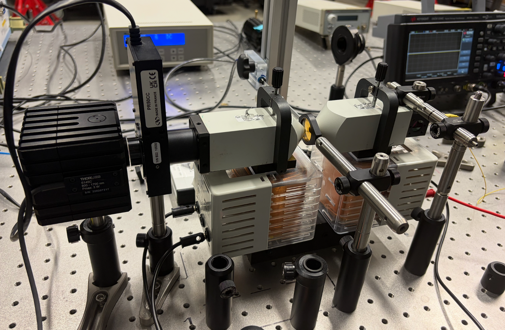
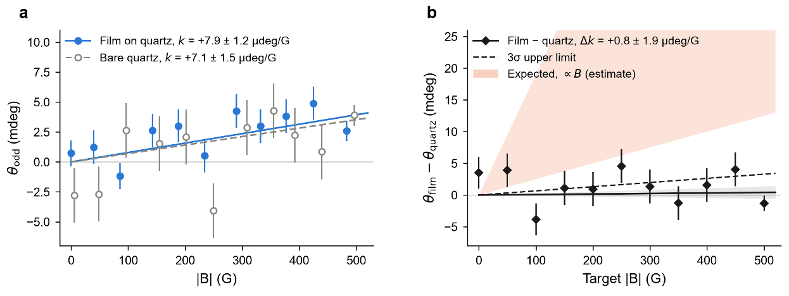
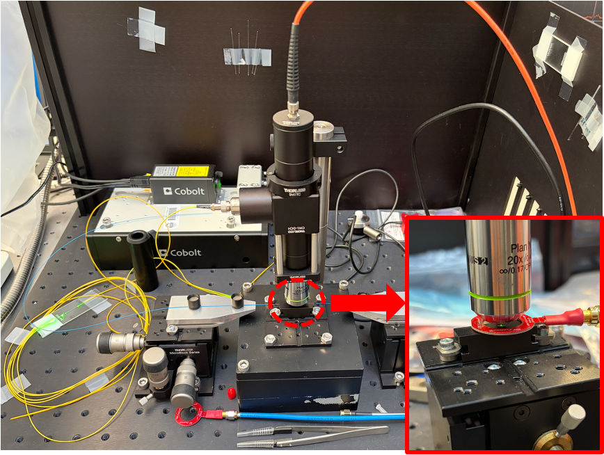
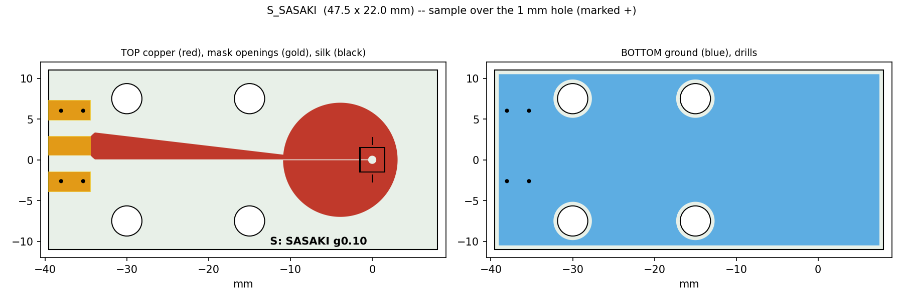
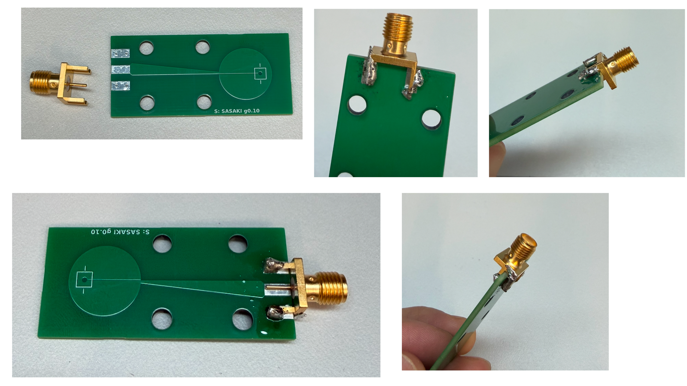
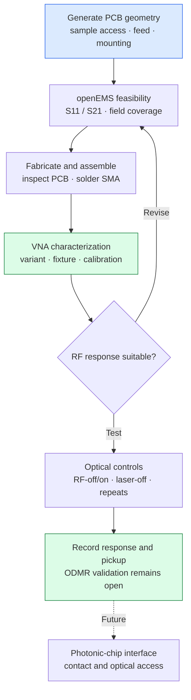
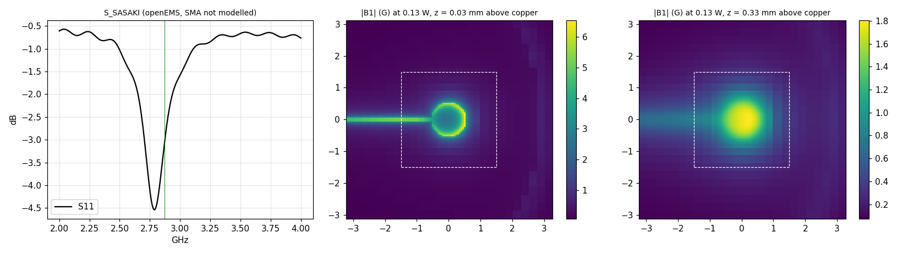
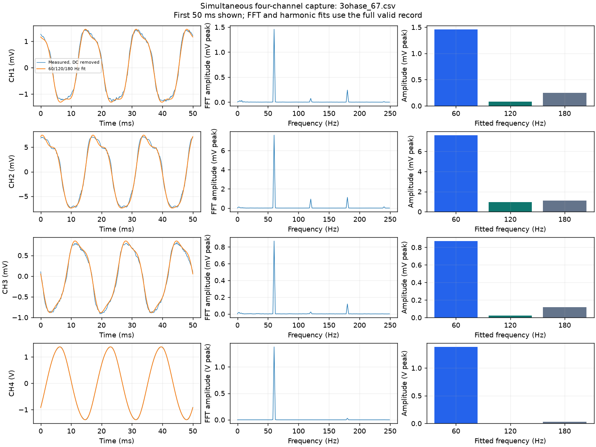

# Photonics Testbenches

**Jun Young Hong · Optical experiments, instrument integration and measurement analysis**

I build optical benches, integrate instrument control and use reference measurements to investigate optical response, noise and repeatability. Three independent experiments are shown here, alongside PCB antenna feasibility work supporting the NV bench.

| Experiment | Engineering question | Evidence |
|---|---|---|
| [Film optical characterization](film_characterization/README.md) | Does the coating response exceed substrate background? | Actual bench, field/wavelength results, control comparison |
| [NV optical and microwave characterization](nv_center/README.md) | Can microwave-dependent optical response be separated from background and RF pickup? | Actual bench, PCB fabrication, FDTD, VNA and optical controls |
| [Oscilloscope signal analysis](oscilloscope_analysis/README.md) | What waveform, harmonic and timing information is present? | Simultaneous measured traces, FFT and fitted harmonics |
| [Instrument integration](instrument_control/README.md) | How are settings, readbacks and optical data kept together? | Instrument roles and acquisition workflow |

## Film optical characterization

Polarization-resolved film-on-quartz measurements compare field and wavelength dependence with a bare substrate. The controls reveal whether a material effect is resolved before a chip interaction length or readout wavelength is selected.

*Measured comparison supplied by the author. At 1550 nm, the film-minus-quartz slope is unresolved within the quoted uncertainty; the shaded expected region is an estimate.*

[Setup, workflow and spectral results →](film_characterization/README.md)

## NV optical and microwave characterization

The bench combines fluorescence characterization with microwave drive and matched controls. PCB test vehicles support feasibility testing before a separate photonic-chip interface is developed.

| PCB design | Fabricated PCB and SMA assembly |
|---|---|
|  |  |

*The photographed board is marked “S: SASAKI g0.10”; the design is based on the cited Sasaki resonator. This documents fabrication and assembly, not measured RF or ODMR performance.*

*Existing openEMS FDTD results; board-only microstrip ports replace SMA connectors. These are predictions, not a fit to the VNA measurements.*

[NV experiment, fabricated-board mounting and control results →](nv_center/README.md)

## Oscilloscope signal analysis

One simultaneous measured capture is used to compare optical-sensor channels with a Hall-reference voltage. Timebase checks, FFT spectra, harmonic fits and residuals expose acquisition and readout limitations. Raw phase is not relabeled as calibrated physical phase.

[Analysis workflow and interpretation →](oscilloscope_analysis/README.md)

## Instrument integration

Python automation coordinates field targets, analyzer rotation, repeated optical-power sampling and timestamped logging. OSA sweep/trace download is a companion workflow. VNA work is separate from the optical acquisition loop.

[Control sequence and instrument roles →](instrument_control/README.md)

## Related published work

- [YIG fiber growth and magneto-optical properties](https://doi.org/10.1021/acs.cgd.5c01776)
- [Interferometric fiber-optic AC magnetometry](https://doi.org/10.1021/acsanm.4c04912)
- [Complete publication list](https://scholar.google.com/citations?user=5lNOIBEAAAAJ&hl=en)

[Content and evidence notes](CONTENT_NOTES.md)

## Research status and future updates

This repository is a growing collection of optical, microwave, and measurement-automation studies. New experiments can be added as independent folders with their own setup, controls, analysis, results, and limitations; existing experiment links remain stable.

| Workstream | Current evidence | Future additions |
|---|---|---|
| **Optical materials & polarization** | Film/substrate controls and wavelength/field comparisons | Additional materials, wavelengths, repeatability tests, and uncertainty analysis |
| **NV optical & microwave experiments** | Optical bench, PCB test vehicles, RF modeling, VNA and optical controls | Improved microwave delivery, background rejection, and controlled ODMR investigations |
| **Signal processing** | Measured oscilloscope traces, FFT, harmonic fits, and residual checks | Multi-run comparisons, calibration, and uncertainty-aware extraction |
| **Instrument automation** | Acquisition workflows and instrument roles | New instruments, reproducible scripts, metadata, and test protocols |

**Evidence convention:** a working testbench or simulated RF field does not by itself demonstrate a sensor response. ODMR and integrated quantum-device operation are not claimed as validated results. Add future findings with dated measurements, relevant controls, and supporting files, subject to confidentiality and IP review.
