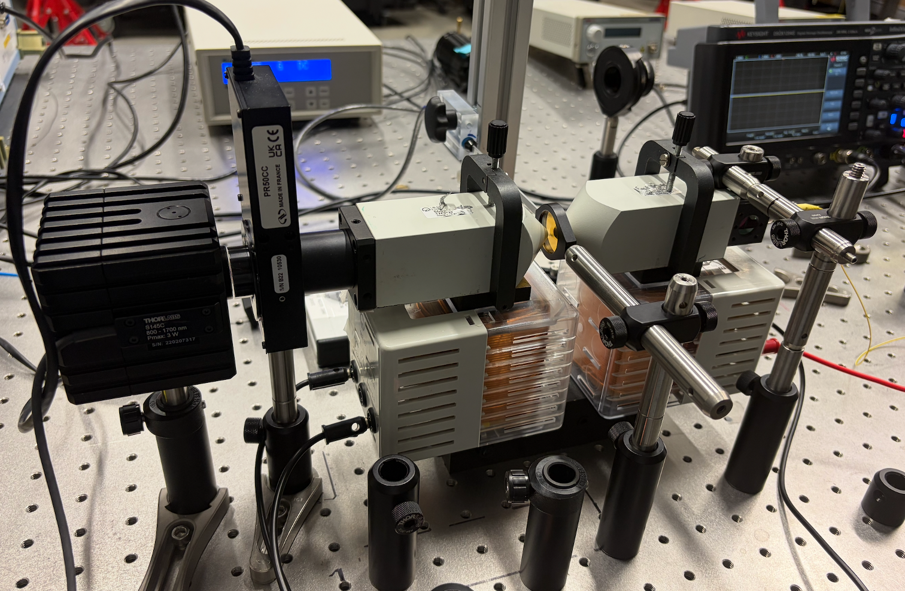
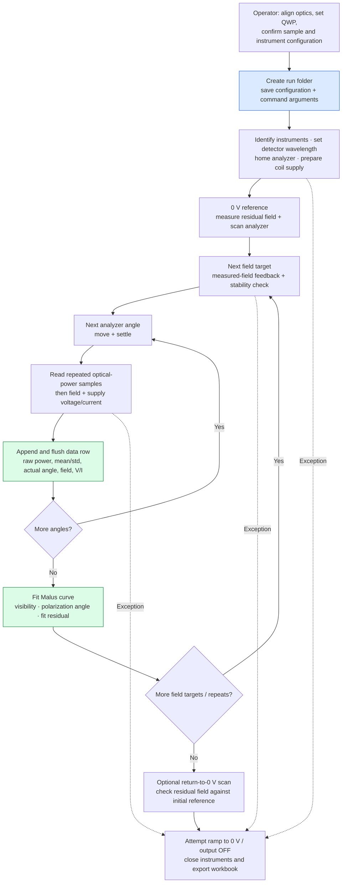
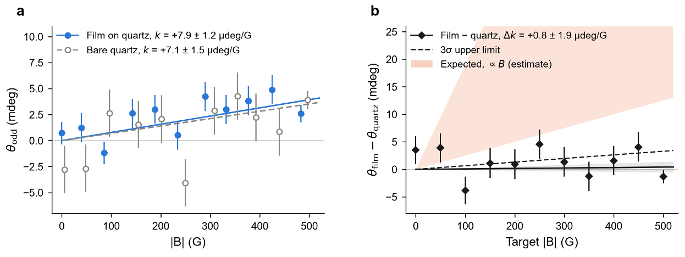
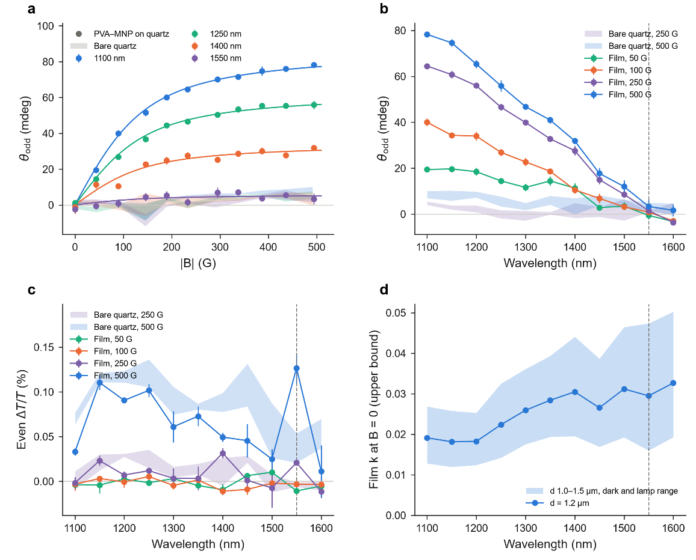
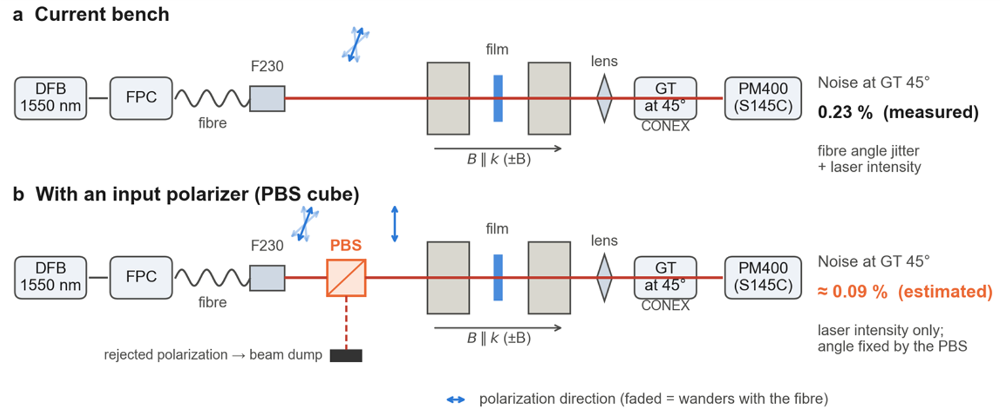

# Polarization-resolved film characterization

[← Portfolio](../README.md)

## Objective

Determine whether a magnetic-composite coating produces a useful optical response beyond quartz background, and assess the wavelength/loss tradeoff before integrated-device design.

## Acquisition workflow

## Measured response and design implications

At 1550 nm, the quoted substrate-subtracted slope is unresolved within uncertainty. This supports further controls and wavelength selection rather than a claim of validated chip sensitivity.

The wavelength dependence informs material and readout selection. The absorption panel is an inferred upper bound under thickness/background assumptions, not an independent direct measurement of the optical constant.

The current-bench noise is labeled measured; the PBS improvement is estimated. It is not presented as a measured before/after improvement.

[Instrument-control source](../instrument_control/README.md)
