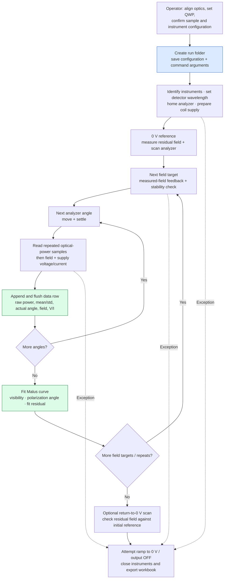

# Instrument integration

[← Portfolio](../README.md)

The acquisition workflow coordinates field targets, motorized analyzer rotation, repeated optical-power reads and measured-field readbacks. Run configuration, raw samples and fitted results are logged together. The OSA workflow acquires companion spectra rather than synchronous VNA/optical data.

| Instrument / role | Integration function |
|---|---|
| Coil supply and Hall reference | Approach field targets and record measured field |
| CONEX analyzer rotation | Move, settle and record angular position |
| PM400 optical power | Acquire repeated samples at each condition |
| AQ6370B optical spectrum analyzer | Configure sweep and retrieve spectral traces |
| Run logging and analysis | Preserve timestamps, settings, readbacks and polarization fits |

Implementation code and equipment configuration are retained privately. The diagram describes the acquisition sequence; it does not imply simultaneous optical/VNA acquisition or independently repeated hardware validation.
