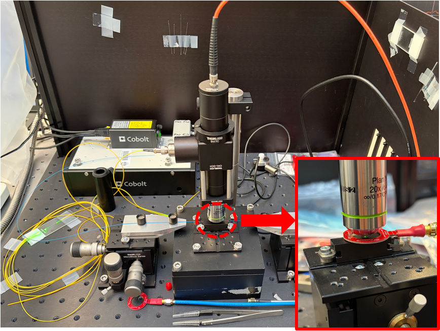
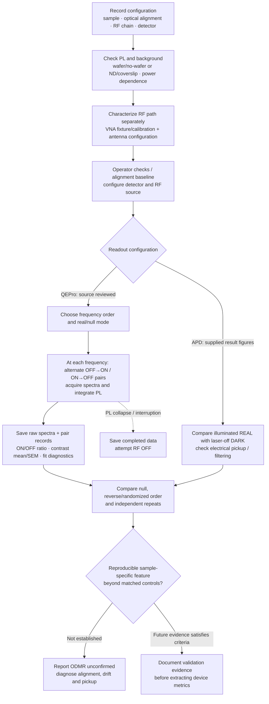
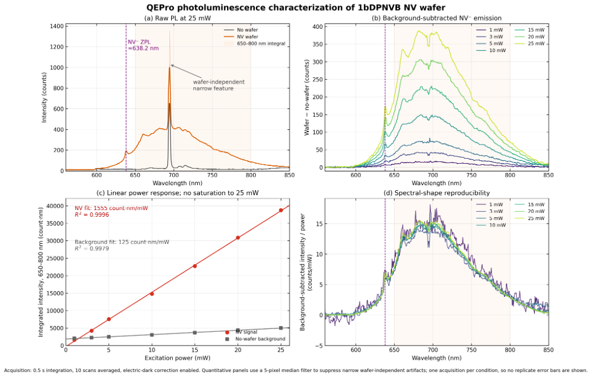
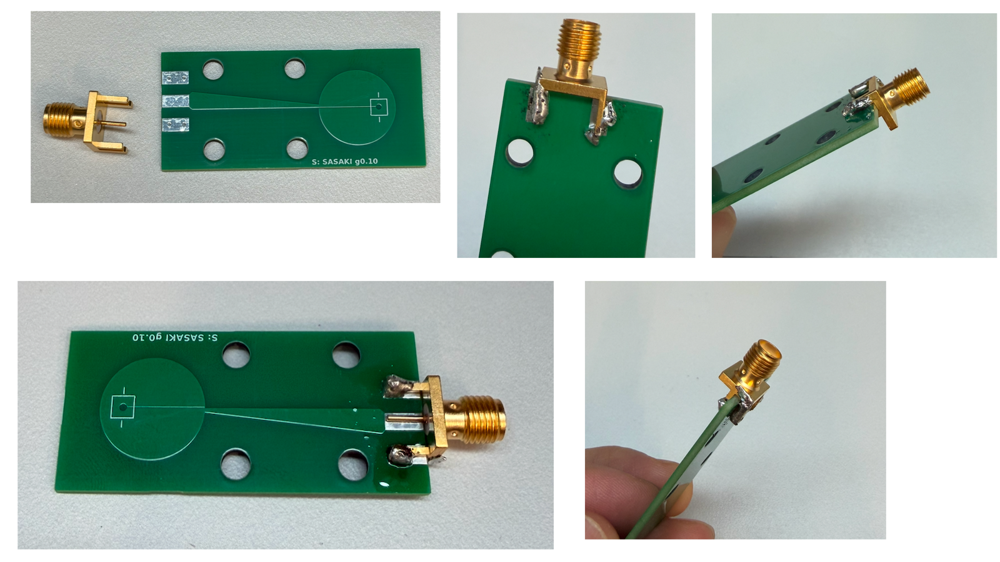
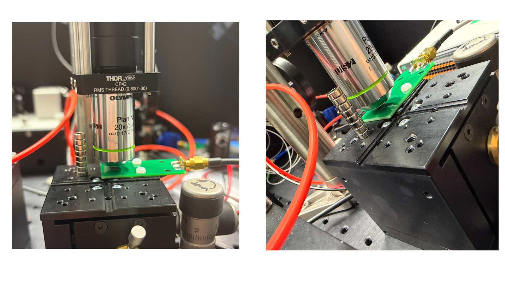
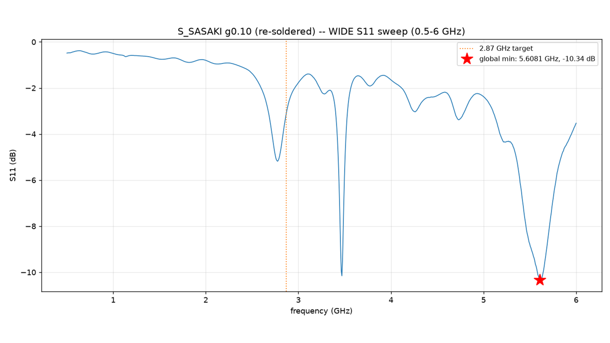
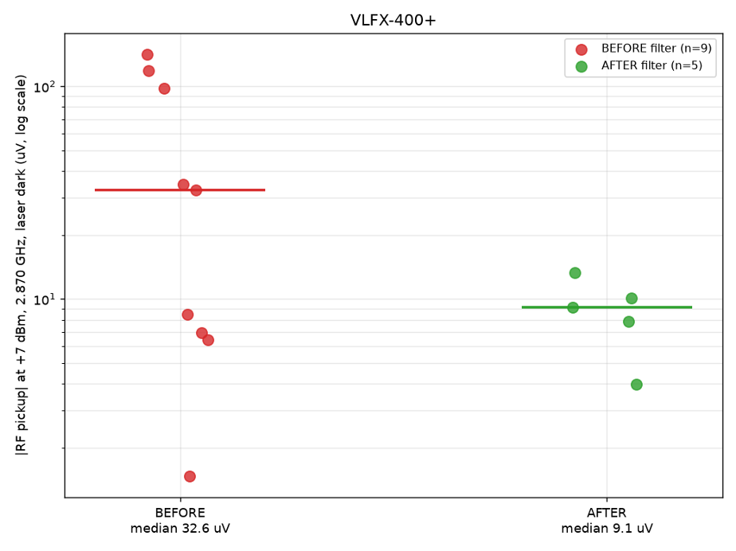

# NV-center optical and microwave characterization

[← Portfolio](../README.md)

## Objective

Establish fluorescence readout and test whether microwave-dependent optical features survive background, electrical-pickup and repeatability controls. PCB feasibility testing precedes photonic-chip interface validation.

## Measurement workflow

## Fluorescence baseline

Sample/background and power-dependent PL establish a usable optical signal; PL alone is not ODMR. The supplied figure reports one spectrum per acquisition condition, without replicate error bars.

## PCB feasibility and assembled hardware

[PCB layout, FDTD results, assumptions and selected source](pcb_feasibility/README.md)

The board marking identifies the g0.10 variant. The g0.12 model is kept separate in the detailed comparison.

The supplied re-soldered PCB trace has its global minimum away from the NV drive target; it is not evidence of successful target-frequency optimization. A quantitative simulation/measurement correlation requires matching board, fixture and calibration records.

## Readout pickup investigation

This is a laser-dark electrical-pickup comparison with unequal sample counts, not a demonstrated ODMR sensitivity improvement. Repeatability and matched optical/RF controls remain the validation criteria. Reproducible ODMR is not established by these plots.
