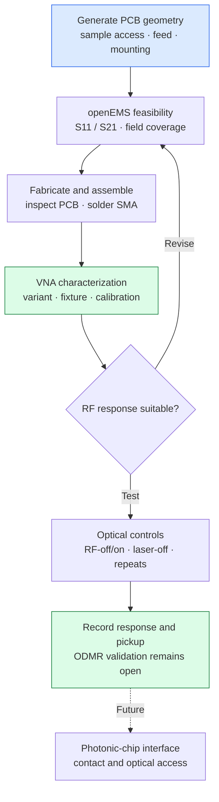
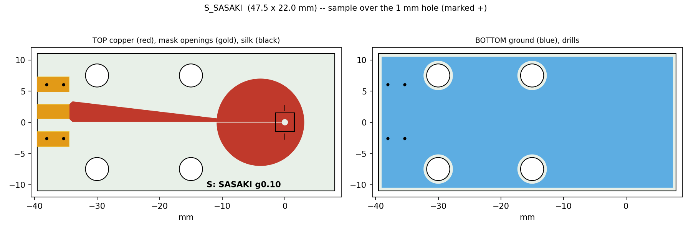
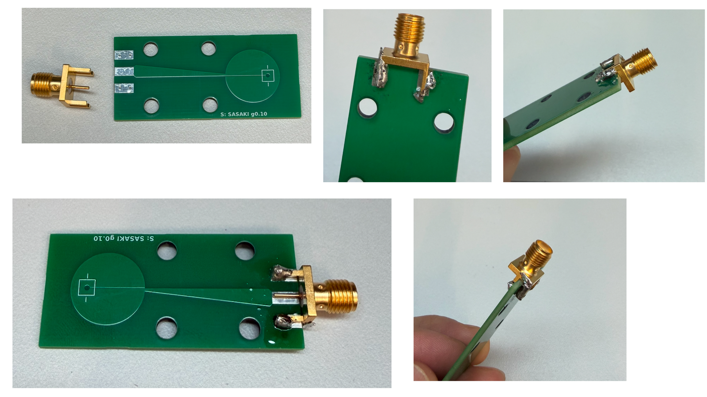
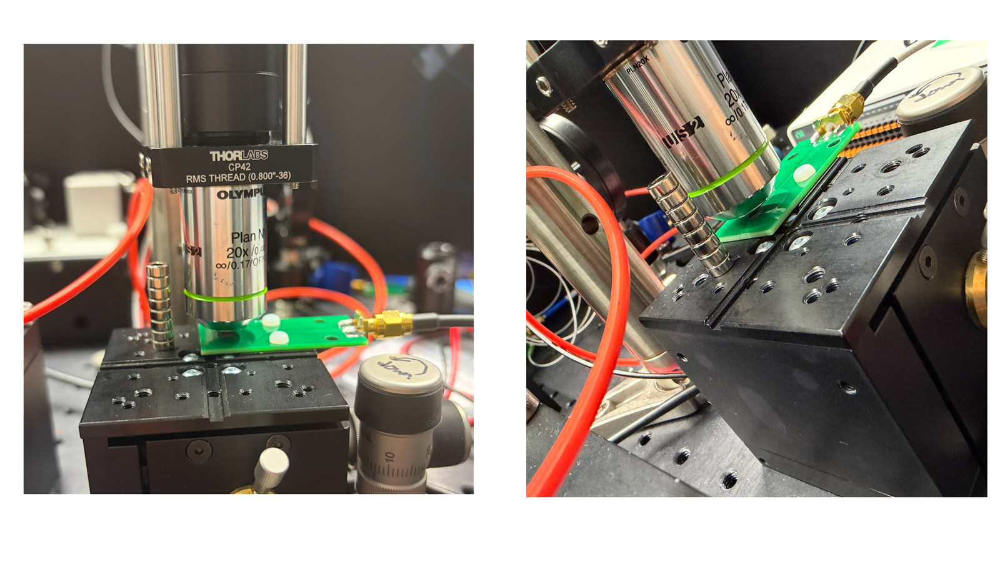
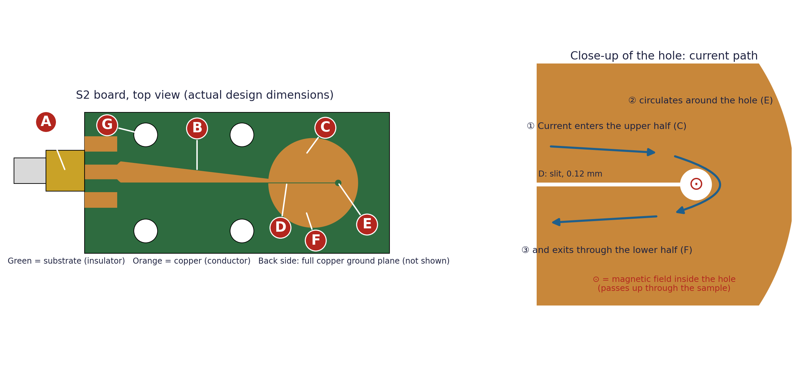
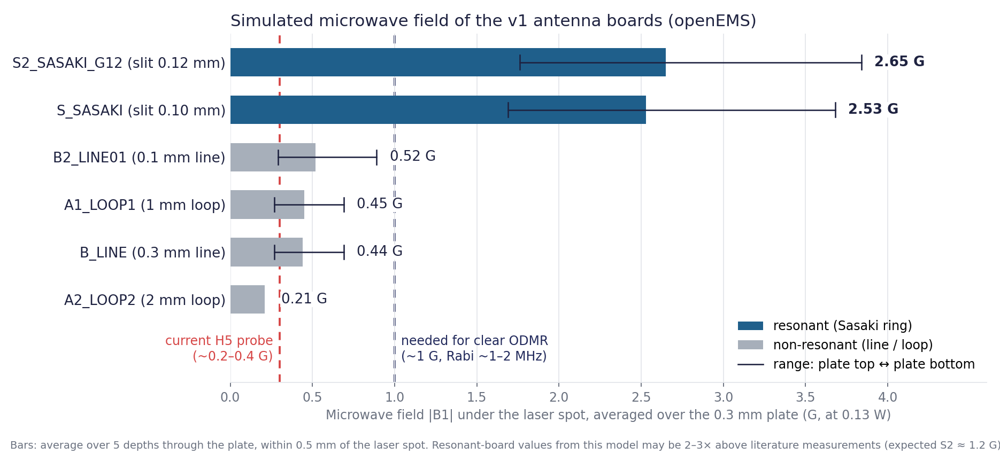
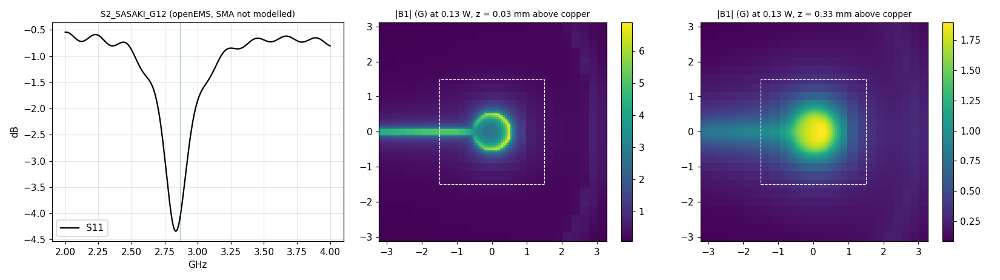

# PCB microwave antennas: feasibility before chip integration

[← NV experiment](../README.md) · [Experimental portfolio](../../README.md#nv-center)

## Why build a separate PCB first?

Before integrating a microwave antenna with a photonic chip, the optical bench needs a practical way to bring microwave excitation close to the diamond while preserving objective access and repeatable mounting. These PCB test vehicles compare resonant and transmission-line structures, then provide hardware for VNA and optical-control experiments. They do not demonstrate completed photonic-chip integration.

*The flow describes the engineering sequence, with decision points and revision loops. It is not a timestamp-verified execution log. Chip-interface hardware validation is a future step; reproducible ODMR is not established.*

## From board design to assembled hardware

| Generated board layout | Fabricated PCB and SMA assembly |
|---|---|
|  |  |

The photographed board is marked **“S: SASAKI g0.10”**, matching the `S_SASAKI` design variant with a nominal 0.10 mm slit. The visible board outline, mounting holes, tapered feed and resonator location are consistent with that layout. The marking identifies the variant; the photograph is not dimensional metrology of the manufactured slit.

The assembled board was mounted in the optical bench beneath the objective. These photographs connect the design study to physical fabrication, connector assembly and optical access; they do not by themselves establish matching or ODMR performance.

The explanatory drawing above shows the **0.12 mm variant (`S2`)**. It belongs to the same resonator family but is not the g0.10 board identified in the assembly photo. The family also includes two-port narrow lines, omega loops and a through-line reference. Board outlines, SMA footprints and mounting holes are generated together. The resonator is based on the Sasaki et al. design cited below; it is not presented as an original antenna topology.

The current-path illustration is conceptual. It does not replace a solved RF surface-current map.

## Compare microwave coverage through the sample thickness

The stored comparison reports field magnitude averaged over five heights through the sample region and a lateral region around the laser spot. The horizontal ranges describe variation with depth, **not statistical error bars**. Resonator and narrow-line candidates trade field concentration against depth dependence and impedance matching.

The dashed “needed for clear ODMR” line in this original figure is a planning heuristic, not a universal detection threshold. Detectability also depends on spin orientation, linewidth, optical collection, noise and acquisition time. The source figure itself flags possible overestimation of resonant-board fields; its absolute field values remain model predictions.

## Full-wave S-parameters and field maps

The openEMS FDTD script reuses top-copper polygons from the Gerber generator. It includes an FR4 substrate and ground plane, replaces SMA connectors with microstrip ports, and models top copper as zero-thickness PEC sheets. Solder mask is omitted. Magnetic-field dumps are normalized using the incident port wave to **0.13 W incident power**; this is not measured delivered power at a fabricated sample. The code computes total complex magnetic-field magnitude, not the orientation-dependent spin-driving component.

The plots therefore represent board-only calculations. Connector/solder parasitics, conductor loss, actual substrate properties, sample loading and mesh sensitivity must be considered before comparing them quantitatively with measurements. The stored notes report unresolved near-surface mesh dependence for narrow lines.

### Check against the stored CSV exports

These values are read directly from the attached simulation exports, without rerunning the solver. “Minimum” refers to the sampled 2–4 GHz range.

| Board | Simulated S11 at 2.87 GHz | Sampled S11 minimum | Frequency at minimum |
|---|---:|---:|---:|
| `A1_LOOP1` | -7.43 dB | -9.60 dB | 2.000 GHz |
| `A2_LOOP2` | -5.31 dB | -7.09 dB | 2.000 GHz |
| `B_LINE` | -10.23 dB | -12.61 dB | 2.000 GHz |
| `B2_LINE01` | -11.06 dB | -13.48 dB | 2.000 GHz |
| `B2_LINE01_r2` | -6.47 dB | -8.41 dB | 2.000 GHz |
| `B3_LINE01_DC` | -11.89 dB | -13.52 dB | 2.315 GHz |
| `T_THRU` | -36.32 dB | -46.85 dB | 2.160 GHz |
| `S_SASAKI` | -3.09 dB | -4.54 dB | 2.785 GHz |
| `S2_SASAKI_G12` | -4.03 dB | -4.34 dB | 2.835 GHz |

## Connect the predictions to the bench

| Stage | Evidence / purpose | Status in this portfolio |
|---|---|---|
| Layout and manufacturing preparation | Geometry generator, board previews and original Gerber outputs | Source ZIP contains manufacturing outputs; this page includes selected previews and results |
| Electromagnetic feasibility | S11/S21 exports and magnetic-field maps | Existing openEMS results; solver not rerun for this page |
| Assembly and mounting | [PCB assembly and sample-mount photographs](../../README.md#nv-center) | Actual hardware photographs |
| VNA characterization | [Existing measured reflection plots](../../README.md#nv-center) | Measurement examples; no calibrated simulation-to-measurement fit claimed |
| Optical validation | RF-off/on, laser-off, repeat/order controls | Candidate-response investigation; reproducible ODMR not established |
| Photonic-chip interface | On-chip antenna modeling (not included in this public selection) | Separate integration study |

The supplied design notes are dated October 1, 2026 and label the openEMS studies October 4, 2026. These are document dates, not independently reconstructed execution timestamps. File ordering is not used to infer when later hardware tests occurred.

## Methods and selected data

The private implementation generates PCB copper geometry, runs openEMS FDTD and processes S-parameters and field dumps. An earlier quasi-static field estimate is a separate approximation from FDTD. Source code and manufacturing outputs are retained privately.

[Stored simulation summary](out/em_sim/em_sim_summary.txt) and board-specific `sparams.csv` files under `out/em_sim/` provide selected numerical results. Raw solver field dumps are not distributed, so this subset does not regenerate the field maps. Historical estimates and planned tests are not treated as validated measurements.

## Design reference

K. Sasaki et al., “Broadband, large-area microwave antenna for optically detected magnetic resonance of nitrogen-vacancy centers in diamond,” *Review of Scientific Instruments* **87**, 053904 (2016). [Author manuscript](https://arxiv.org/abs/1605.04627).
