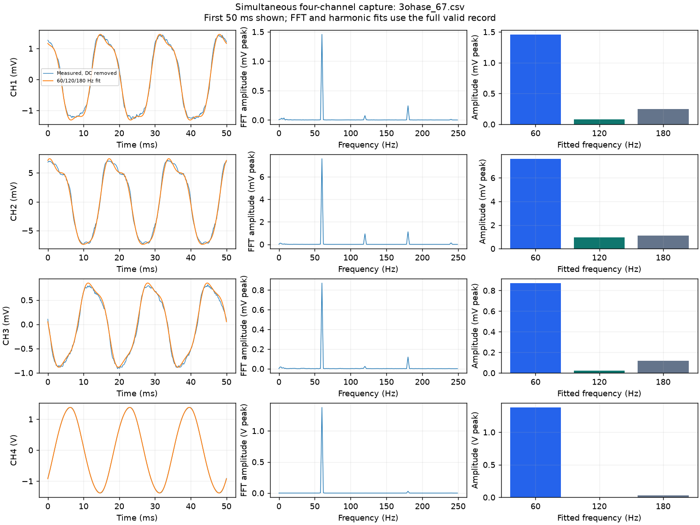
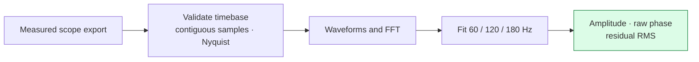

# Oscilloscope waveform and harmonic analysis

[← Portfolio](../README.md)

## Objective

Assess whether coated-fiber optical channels retain the waveform and harmonic content of magnetic excitation, using a simultaneous Hall-reference channel.

The existing dashboard uses one measured simultaneous capture. Optical channels and the Hall-reference voltage are analyzed on the recorded timebase without channel substitution or forced phase inversion.

The analysis implementation and raw research captures are retained privately. The dashboard shows an existing measured-data analysis, rather than a publicly reproducible dataset. Voltage-domain analysis does not establish magnetic sensitivity or calibrated physical phase.
